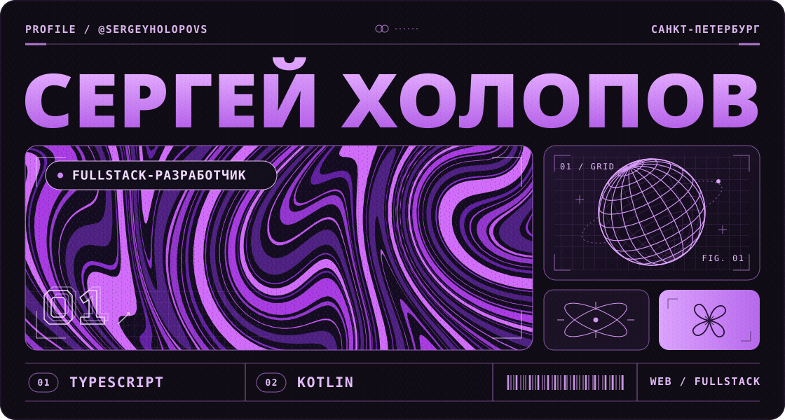

# Сергей Холопов

**Fullstack-разработчик · Санкт-Петербург**

Делаю веб-приложения от интерфейса до сервера. Пишу на TypeScript и Kotlin: на клиенте работаю с React, Next.js, Vue и Nuxt, на сервере — со Spring Boot.

**Мой сайт:** [sergeyholopov.ru](https://sergeyholopov.ru/) · [Telegram](https://t.me/Sergey_Holopov) · [Почта](mailto:gssdsudas@gmail.com)

## 01 / Сейчас

- **ЦКБ «Айсберг».** Работаю инженером-программистом.
- **TXA Technologies.** Руковожу направлением программирования.
- **СПбГМТУ.** Учусь на бакалавриате на факультете цифровых промышленных технологий.

## 02 / Проекты

- **[FluffyRP](https://fluffyrp.com/) · Frontend.** Работал над фронтендом сайта Minecraft-сервера по частному заказу.
- **[CineNetwork](https://github.com/CineNetwork/Frontend) · Fullstack.** Отвечал за SSR-фронтенд на Next.js: каталог, страницы тайтлов, плеер и личный кабинет. Участвовал в разработке сервисов Anime и Auth.
- **[Payly](https://github.com/SergeyHolopovS/payly-kotlin) · Backend.** Платёжный шлюз с симулятором эквайера, отменой платежей и частичными возвратами. Реализовал идемпотентность через Redis, transactional outbox с Kafka и подписанные вебхуки с повторными попытками доставки. Метрики в Prometheus и Grafana, интеграционные тесты с Testcontainers.
- **[EasyGuide](https://github.com/SergeyHolopovS/easyguide-nuxtjs) · Frontend.** Платформа бронирования экскурсий на Nuxt 4 с SSR и фильтрами в URL. Обновление JWT между вкладками координируется через Web Locks API.
- **[PickMe](https://github.com/PickMeApp/mini-app) · Fullstack.** Telegram Mini App на React и TypeScript. Написал клиент и сервер, подключил авторизацию через Telegram `initData` и настроил деплой через GitHub Actions.
- **[EukoLand](https://github.com/EukoLand/frontend-react) · Frontend.** React SPA для игрового проекта с личным кабинетом. Для серверного состояния использовал TanStack Query, для состояния интерфейса — Zustand.
- **[Allitta](https://github.com/SergeyHolopovS/Allitta) · Frontend.** React-приложение с админкой, авторизацией, формами и загрузкой файлов через REST API. Окружение в Docker.

Учебные и небольшие проекты

- [nuxt-blog](https://github.com/SergeyHolopovS/nuxt-blog) и [vue-todos](https://github.com/SergeyHolopovS/vue-todos) — SSR-блог и задачник на Vue.
- [giftis-react](https://github.com/SergeyHolopovS/giftis-react) и [giftis-kotlin](https://github.com/SergeyHolopovS/giftis-kotlin) — веб-клиент и API.
- [authexample](https://github.com/SergeyHolopovS/authexample) и [konews](https://github.com/SergeyHolopovS/konews) — JWT-авторизация и агрегатор новостей.
- [CryptoCheck](https://github.com/SergeyHolopovS/CryptoCheck) и [discord-stats-bot](https://github.com/SergeyHolopovS/discord-stats-bot) — курсы криптовалют и статистика Discord.

## 03 / Стек

| Направление | Технологии |
| --- | --- |
| **Frontend** | TypeScript, JavaScript, React, Next.js, Vue 3, Nuxt, HTML, CSS |
| **Интерфейсы и данные** | TanStack Query, Zustand, Tailwind CSS, SCSS, CSS Modules, REST, WebSocket, JWT |
| **Backend** | Kotlin, Spring Boot, PostgreSQL, Redis, Kafka, RabbitMQ, микросервисы |
| **Инструменты** | Docker, Git, GitHub Actions, Vite, pnpm, ESLint, Prettier, Jest, Testcontainers |
