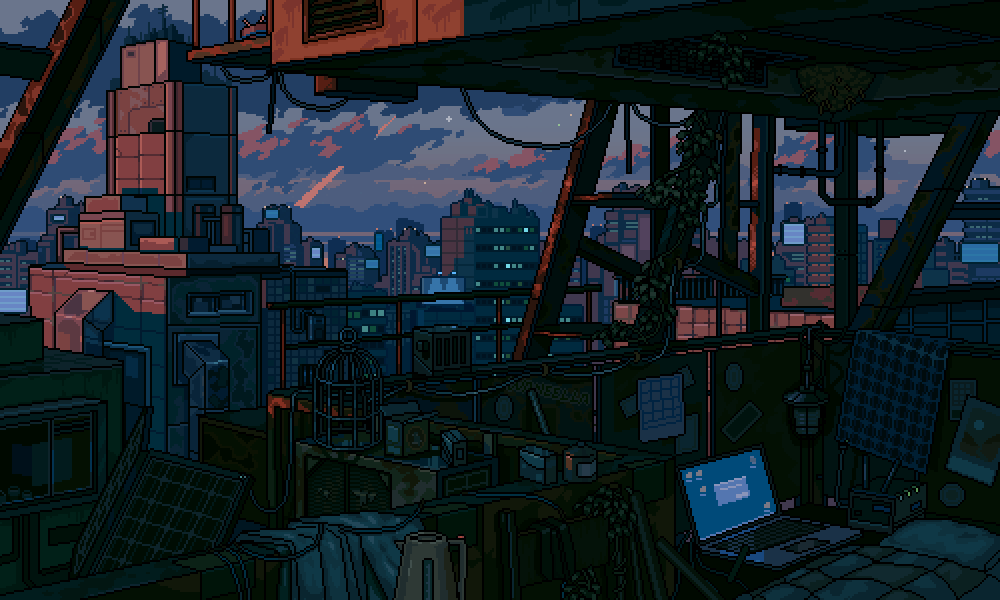

<!-- MasterHead -->

<!-- Greeting -->
</h1>
<h1 align="center">Namaste 🙏 I'm Sergey Holopov</h1>

<h4 align="left">🌟I am Sergey Kholopov. I am a student of Saint-Petersburg State Marine Technical University. I am actively engaged in web development, focusing on both frontend and backend aspects.
  
As I embark on this new academic journey, I am eager to explore various dimensions of the IT industry. I am particularly interested in emerging technologies and trends that shape our digital landscape. My ultimate goal is to build a successful career in web development, where I can contribute to innovative projects and continuously enhance my expertise. I look forward to the opportunities that lie ahead and am committed to making the most of my educational experience.</h4>

 

<!-- Profile Views -->

<!-- Total Stars with GitHub Logo -->

<!-- Followers with GitHub Logo -->

<!--👀VIEWS / 🌐WEBSITE: https://github.com/antonkomarev/github-profile-views-counter -->

<!-- about me -->
 <h3 align="left">💫 About Me</h3>

<h4> 
  🌱 I am currently working on and developing my programming skills. 
 🔭 I worked on React, Spring and Next projects. 
 💬 Skills I acquire in programming languages such as Typescript, Java, Rust. 
 ⚡ Interest in FrontEnd, BackEnd, Linux hardware. 
 ✨ I only like speed.</h4> 

  <h3>🧲 Connect me :</h3>

  

</h4>

 
  
<!-- Proudly created with GPRM ( https://gprm.itsvg.in ) -->
  

  

<!-- lang-->
<h3 align="center">📚 Languages & tools I Have placed My Hands On </h3>

 

     
     
     

